# Walkthrough — multi-user behaviour, with evidence

Every screenshot below was captured from the running app (Django on MySQL, React in a real
Chromium browser) during development, not mocked up.

---

## 1. Sign in

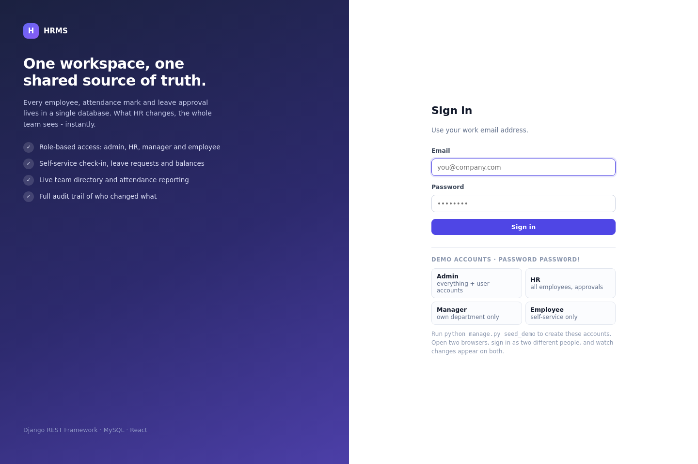

Email + password → JWT. The four demo accounts are pre-filled buttons; each lands on a
differently scoped dashboard.

---

## 2. One dashboard, four scopes

The same `/api/dashboard/` endpoint returns different data depending on role.

**Admin / HR** — organisation cards, headcount by department, shared activity feed:

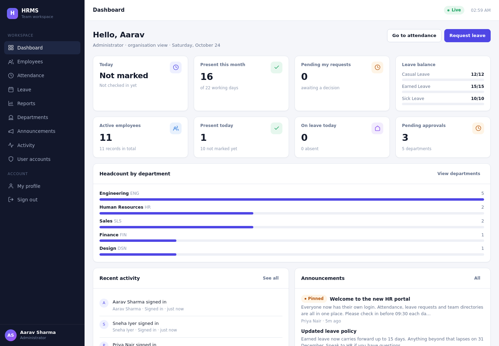

**Employee** — only personal cards: today's check-in state, days present this month,
pending requests, leave balances:

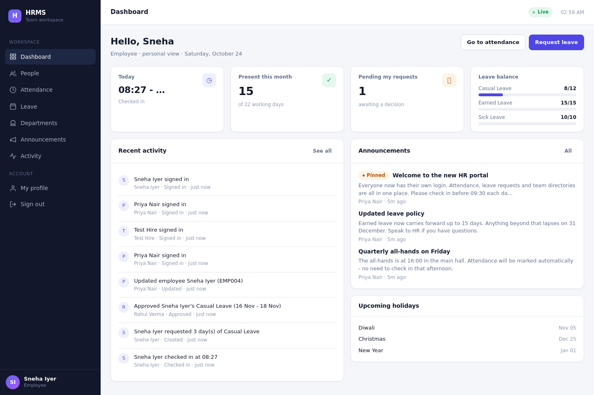

The response literally differs: an employee's payload has no `org` key and no
`department_breakdown`, because those queries never run for them.

---

## 3. Role-scoped reads

`GET /api/employees/` for the same database:

| Signed in as | Rows returned |
|---|---|
| Admin | 10 |
| HR | 10 |
| Manager (Engineering) | 4 — self + department + direct reports |
| Employee | 1 — themselves |

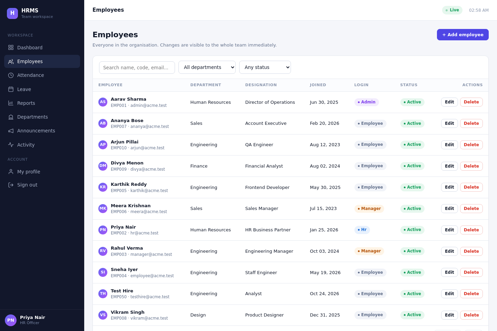

The employee view of the same page (note the shortened sidebar — no Reports, no User accounts):

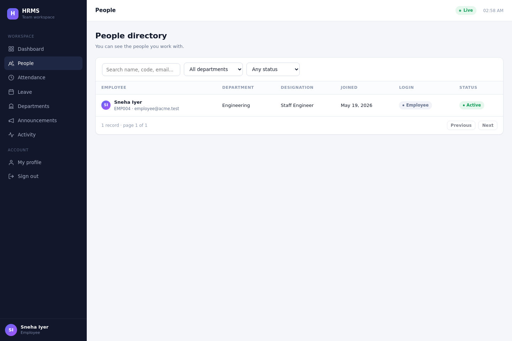

Opening a colleague's record by URL returns **404**, not 403 — the row simply isn't in their
queryset, so the API doesn't confirm it exists.

---

## 4. Self-service attendance

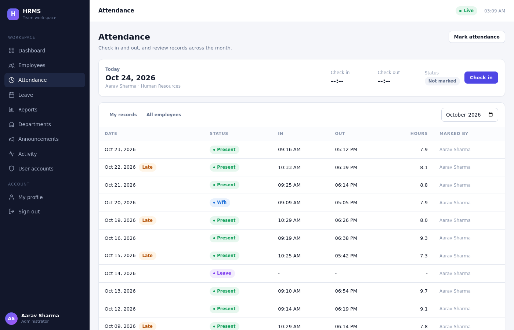

- "My records" is filtered by `?mine=true`, so it shows only the signed-in person's rows even
  for an admin.
- Check-in creates today's row inside a `select_for_update()` transaction; a second check-in
  returns `400 You already checked in at 08:27 today` instead of overwriting the timestamp.
- `worked_minutes` is computed on save; anything after **09:30** is flagged **Late**.

HR marking a whole group at once:

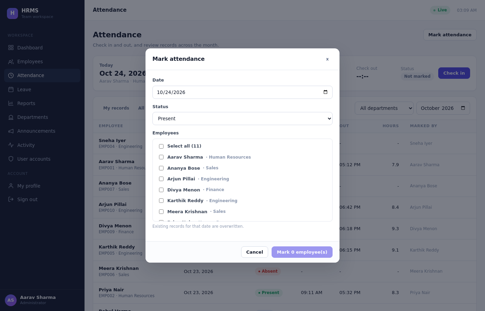

---

## 5. Leave workflow

Apply → notify → approve → attendance updates.

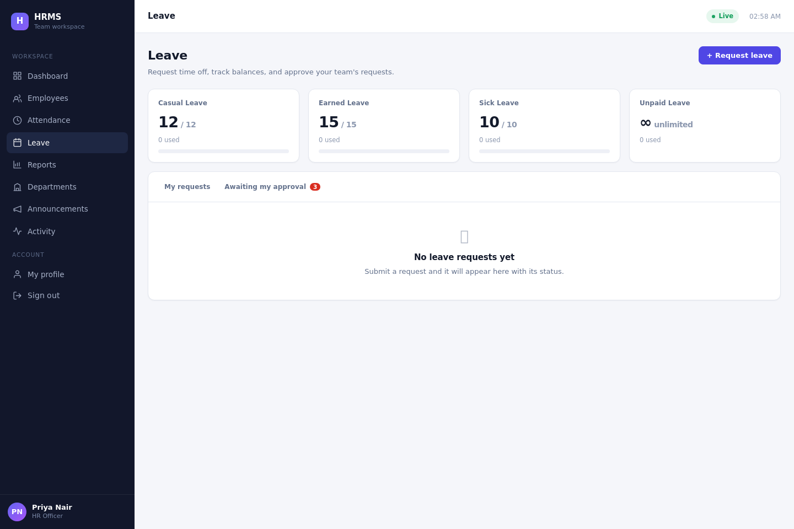

A request can't overlap an existing one, can't exceed the remaining quota, and weekends are
excluded from the day count. Approval writes `LEAVE` rows into `Attendance` for every working
day in the range (skipping holidays); cancellation deletes them again.

Manager/HR view — approve or reject with an optional note:

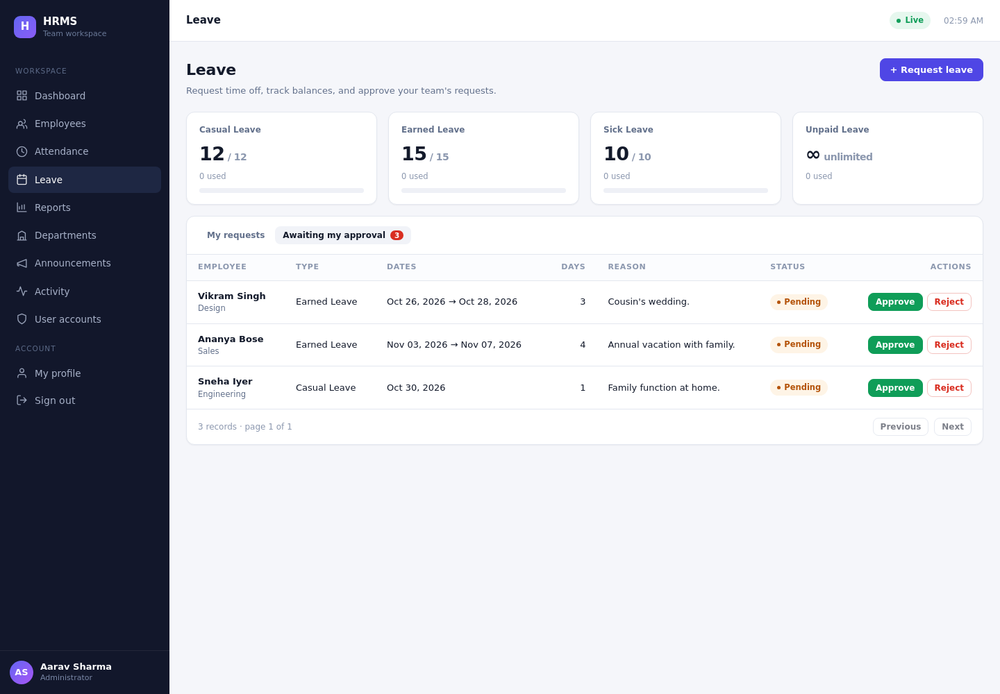

Nobody can approve their own request, and a manager only sees requests from their own
department. Both rules are enforced server-side and covered by tests.

---

## 6. The shared-state proof

Two browsers, two sessions, no refresh button pressed.

```
employee tab has the notice already? 0
HR posted it.
-> employee's OPEN page showed the new notice after 5.8s (no reload)
employee saved profile: true
-> HR's employee list showed the edit after 0.0s (no reload)
```

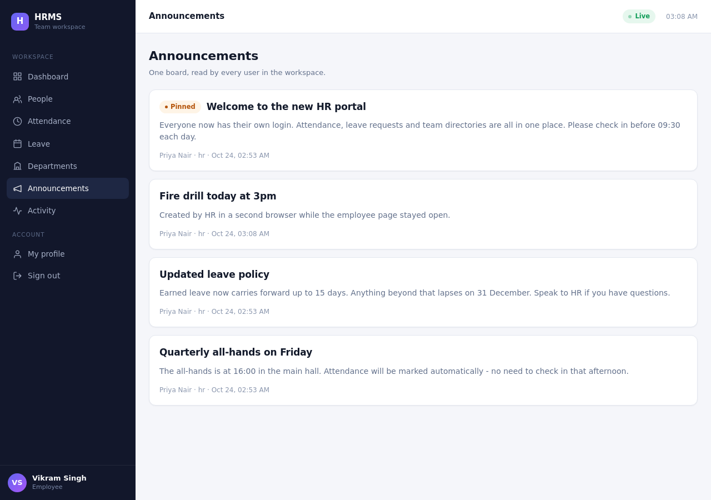

The mechanism is deliberately simple and honest: each page re-fetches on a 10-second interval
and whenever the tab regains focus, so a user looking at the screen sees the change within one
cycle. The 0.0s figure is the focus-triggered refresh.

The reverse direction — an employee edits their own profile, and the name in HR's directory
changes too — is enforced by a transactional serializer that updates the `User` row and the
linked `Employee` row together. Before that fix the two could drift apart; a test now pins it.

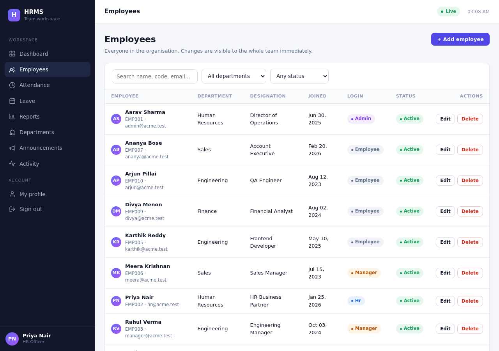

---

## 7. Reports built on SQL aggregates

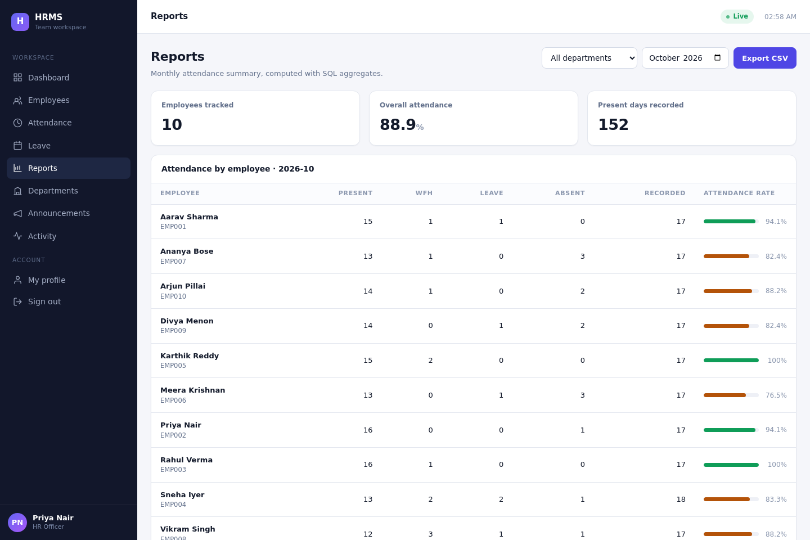

One query per report using `values().annotate(Count(..., filter=Q(...)))`, which Django
compiles to `SELECT ... LEFT JOIN ... GROUP BY`. The CSV export uses the same numbers.

---

## 8. Accountability

Every mutation writes an audit row. The feed is visible to all users, so a team can see who
changed what without asking.

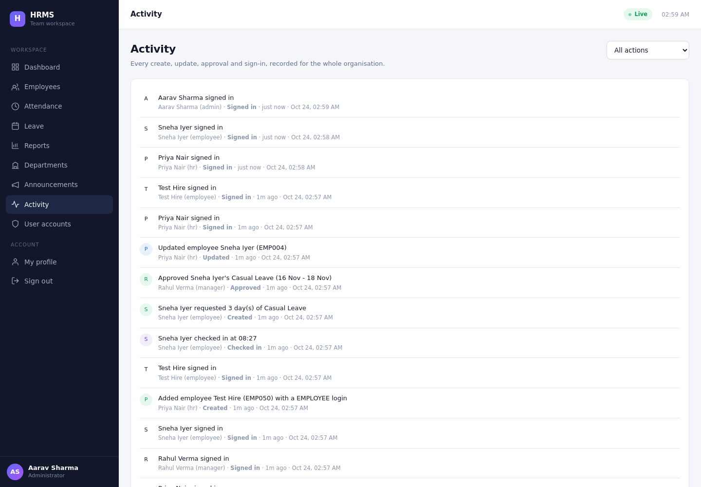

---

## 9. Administration

User accounts — role changes apply on the user's next request because permissions are read
from the database row, not from a token claim:

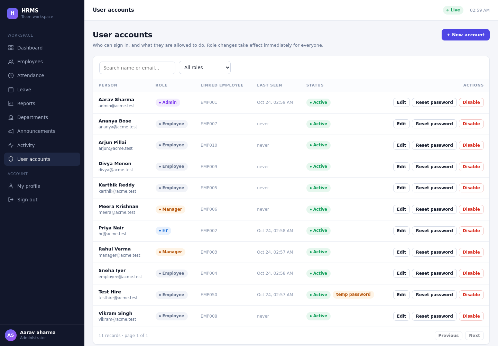

---

## Reproducing the demo

```powershell
cd backend
python manage.py seed_demo --flush
python manage.py runserver
```

```powershell
cd frontend
npm start
```

Then open <http://localhost:5173> in two windows and sign in as `hr@acme.test` and
`employee@acme.test` (password `Passw0rd!`).
